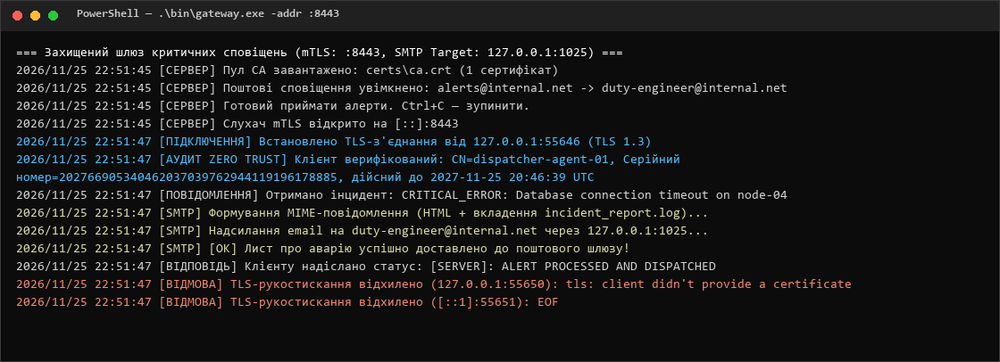
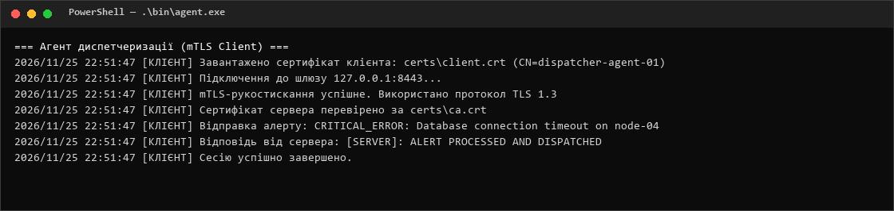
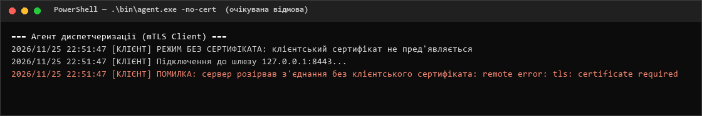
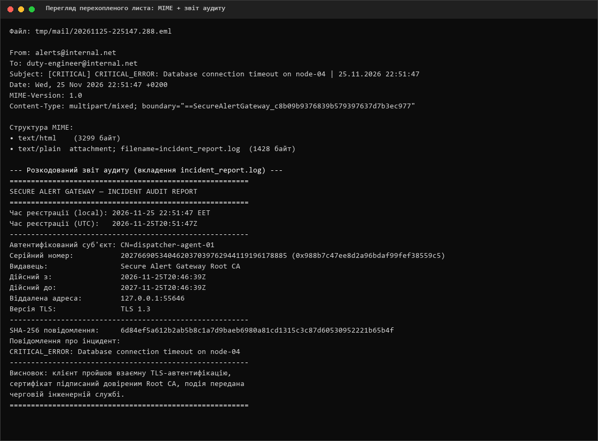
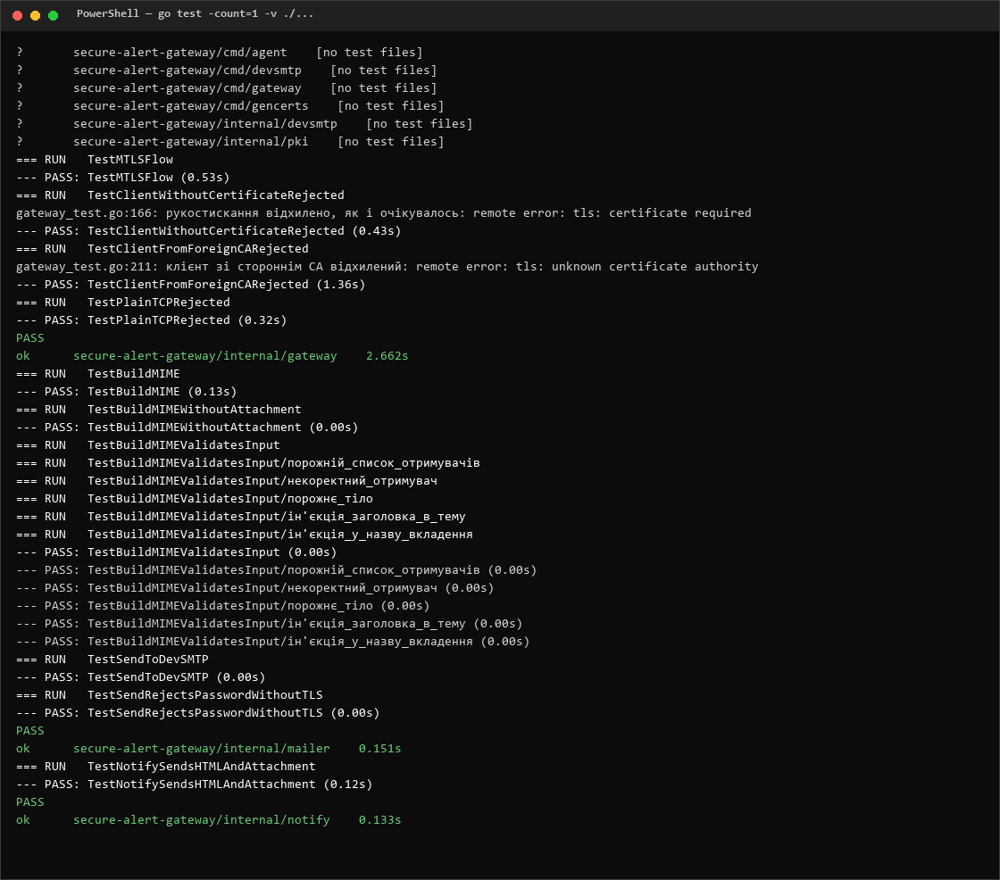

# Практична робота № 3. Secure Alert Gateway: mTLS + SMTP

**Тема:** налаштування захищеного каналу mTLS та протокол SMTP.
**Виконав:** студент групи КН-41, Сочка О.В.
**Варіант:** базовий + ключовий + просунутий (Рівні 1–3).

Консольний шлюз критичних сповіщень: агент диспетчеризації підключається до шлюзу
по **mTLS**, шлюз перевіряє сертифікат клієнта, фіксує його ідентичність (CN, серійний
номер, термін дії) і надсилає черговому інженеру **HTML-лист із вкладенням**
`incident_report.log` через SMTP.

---

## 1. Мета роботи

1. Розібратися, як працює PKI і X.509: Root CA → серверний сертифікат → клієнтський сертифікат.
2. Налаштувати двосторонню TLS-автентифікацію на `crypto/tls` і переконатися, що клієнт
   без сертифіката отримує відмову ще на рукостисканні.
3. Реалізувати відправку пошти через `net/smtp`, сформувати MIME-лист
   (`multipart/mixed`, HTML + Base64-вкладення).
4. Перевірити все локально: без інтернету, Docker і реальної поштової скриньки.

---

## 2. Що виконано за рівнями

| Рівень | Що зроблено | Статус |
|---|---|---|
| 1. Базовий | Go-модуль, `certs/`, Root CA + server + client, mTLS-сервер на `:8443`, mTLS-клієнт, відмова клієнту без сертифіката | ✅ |
| 2. Ключовий | Окремий пакет `mailer` на `net/smtp`, параметризований лист, інтеграція в обробник події, лист на `duty-engineer@internal.net` | ✅ |
| 3. Просунутий | Аудит `PeerCertificates` (CN, serial, строки дії), MIME `multipart/mixed` з HTML і Base64-вкладенням, звіт `incident_report.log` | ✅ |
| Додатково | Юніт- та інтеграційні тести, `go vet`, власний SMTP-емулятор `devsmtp` для офлайн-демонстрації, обробка помилок і graceful shutdown | ✅ |

---

## 3. Технології

- **Go 1.23.4** (модуль `secure-alert-gateway`, лише стандартна бібліотека — зовнішніх залежностей немає).
- `crypto/tls`, `crypto/x509`, `crypto/rsa`, `encoding/pem` — PKI і захищений канал.
- `net/smtp`, `mime`, `mime/multipart`, `encoding/base64`, `html/template` — пошта.
- Windows 10/11 + PowerShell 5.1 (перевірено), проєкт також збирається на Linux/macOS.
- Git для версіонування.

---

## 4. Структура проєкту

```text
.
├── cmd/
│   ├── gateway/main.go      # mTLS-шлюз: приймає алерти, шле листи
│   ├── agent/main.go        # mTLS-клієнт; -no-cert для демонстрації відмови
│   ├── gencerts/main.go     # генерація PKI мовою Go (без openssl)
│   └── devsmtp/main.go      # локальний SMTP-емулятор для демонстрації
├── internal/
│   ├── pki/                 # X.509: генерація, завантаження TLS-конфігів, Identity
│   ├── gateway/             # TCP-сервер, аудит клієнта, протокол одного рядка
│   ├── mailer/              # net/smtp + складання MIME (mime.go)
│   ├── notify/              # Alert → тема, HTML, звіт аудиту, виклик mailer
│   └── devsmtp/             # мінімальний SMTP-сервер (приймає лист у .eml)
├── certs/                   # ca.crt, server.crt, client.crt (генеруються локально)
├── scripts/
│   ├── generate_certs.ps1   # обгортка над go run ./cmd/gencerts
│   └── generate_certs.sh    # альтернатива через openssl (Linux/macOS/Git Bash)
├── docs/
│   ├── logs/                # фактичні логи запуску, з яких зроблено скріншоти
│   └── screenshots/         # скріншоти роботи програми
├── go.mod
├── .gitignore
└── README.md
```

Ключі `*.key` і згенеровані сертифікати в Git не потрапляють (`.gitignore`), бо це секрети.
У репозиторії зберігається лише `.gitkeep`.

---

## 5. Архітектура

### 5.1. Схема взаємодії

```text
┌──────────────────────┐        mTLS, TLS 1.3, :8443         ┌───────────────────────┐
│  cmd/agent           │ ──────────────────────────────────▶ │  cmd/gateway          │
│  client.crt/key      │                                     │  server.crt/key       │
│  довіряє ca.crt      │ ◀────────────────────────────────── │  ClientCAs = ca.crt   │
└──────────────────────┘   "[SERVER]: ALERT PROCESSED..."    └───────────┬───────────┘
                                                                          │
                                                       net/smtp, :1025    │
                                                                          ▼
                                                              ┌───────────────────────┐
                                                              │ Mailpit / devsmtp     │
                                                              │ (лист .eml + веб-UI)  │
                                                              └───────────────────────┘
```

### 5.2. Компоненти і зони відповідальності

| Пакет | Відповідальність | Чому окремо |
|---|---|---|
| `internal/pki` | генерація CA/серверного/клієнтського сертифікатів, `tls.Config`, читання `Identity` зі станції з'єднання | криптографія не змішується з бізнес-логікою; тести генерують тимчасовий PKI |
| `internal/gateway` | слухач, TLS-рукостискання, аудит клієнта, читання повідомлення, відповідь | це транспортний рівень; він не знає, як саме надсилається пошта |
| `internal/notify` | перетворення `Alert` у тему/HTML/звіт і виклик пошти | шаблон листа можна змінити, не чіпаючи TLS |
| `internal/mailer` | SMTP-діалог і складання MIME | можна перевикористати в іншому сервісі |
| `internal/devsmtp` | приймає лист і зберігає `.eml` | дає змогу запускати демо без Docker/Mailpit |

Зв'язок іде в один бік: `cmd/gateway` → `gateway` → (`notify` → `mailer`). Пакет `gateway`
не імпортує `notify`, він приймає функцію `Notifier`, тому його легко тестувати з підставним
обробником. Це той самий принцип, що й `http.Handler`, тільки для TCP.

### 5.3. Що відбувається при одному алерті

1. Клієнт відкриває TCP до `127.0.0.1:8443` і починає TLS-рукостискання.
2. Сервер надсилає свій сертифікат; клієнт перевіряє його ланцюжок до `ca.crt` і збіг
   `localhost`/`127.0.0.1` із SAN.
3. Сервер надсилає `CertificateRequest`, клієнт пред'являє `client.crt`.
4. Сервер перевіряє підпис клієнтського сертифіката своїм `ClientCAs`, EKU `ClientAuth`
   і строки дії. Без цього рукостискання не завершується.
5. Після рукостискання шлюз бере `conn.(*tls.Conn).ConnectionState().PeerCertificates[0]`
   і формує `pki.Identity` (CN, serial, notBefore/notAfter, issuer).
6. Шлюз читає один рядок (до `\r\n`, максимум 64 КіБ, таймаут 10 с), логує його.
7. `notify.Notify` будує HTML-лист і звіт аудиту, `mailer.Send` передає його SMTP-серверу.
8. Клієнту повертається `[SERVER]: ALERT PROCESSED AND DISPATCHED` (або
   `... EMAIL DISPATCH FAILED`, якщо пошта не пішла).
9. З'єднання закривається; кожне підключення обслуговується окремою горутиною.

### 5.4. Протокол застосункового рівня

Протокол навмисно простий, бо головне в роботі — TLS:

```text
клієнт → сервер:  CRITICAL_ERROR: Database connection timeout on node-04\r\n
сервер → клієнт:  [SERVER]: ALERT PROCESSED AND DISPATCHED\r\n
```

Чому саме так:

- один рядок легко читати очима і парсити без зайвих залежностей;
- обмеження розміру (64 КіБ) не дає клієнту завалити пам'ять сервера;
- таймаут читання не дає «зависнути» на клієнті, який підключився і мовчить;
- відповідь надсилається лише після того, як спрацював обробник, тому клієнт бачить
  реальний результат, а не «прийнято» навмання.

---

## 6. PKI: що саме згенеровано

| Файл | Призначення | CN | Ключові розширення |
|---|---|---|---|
| `certs/ca.crt` | корінь довіри | `Secure Alert Gateway Root CA` | `CA:TRUE`, `keyCertSign`, `cRLSign` |
| `certs/server.crt` | сертифікат шлюзу | `localhost` | `EKU=serverAuth`, SAN `DNS:localhost, IP:127.0.0.1, IP:::1` |
| `certs/client.crt` | сертифікат агента | `dispatcher-agent-01` | `EKU=clientAuth`, `digitalSignature` |

Генерація:

```powershell
go run ./cmd/gencerts -dir certs
# або
.\scripts\generate_certs.ps1
```

Генератор написаний на Go (`crypto/x509`), тому працює однаково на Windows/Linux/macOS
і не потребує openssl. Версія через openssl лежить у `scripts/generate_certs.sh` —
вона робить той самий ланцюжок (CA → server → client) із SAN та EKU.

Навіщо кожне поле:

- **IsCA + KeyUsageCertSign** — щоб сертифікатом можна було підписувати інші сертифікати.
- **BasicConstraints / MaxPathLen=0** — CA не може видавати проміжні CA, лише кінцеві сертифікати.
- **SAN** — перелік імен та IP, для яких сертифікат дійсний. Саме за SAN, а не за CN,
  сучасні клієнти перевіряють, чи той це сервер.
- **ExtendedKeyUsage** — розділяє серверні та клієнтські сертифікати: навіть якщо
  підмінити сертифікати місцями, перевірка EKU не пропустить.
- **Серійний номер** — 128 випадкових бітів; використовується для ідентифікації та
  (у майбутньому) відкликання.
- **Окрема пара ключів для кожного вузла** — компрометація ключа агента не компрометує CA.

Приватні ключі записуються з правами `0600` (у міру можливостей ОС). У Git вони не потрапляють.

---

## 7. Запуск

Потрібен лише Go 1.22+. Усі команди — з кореня проєкту.

### Крок 1. Згенерувати сертифікати

```powershell
go run ./cmd/gencerts -dir certs
```

Очікуваний результат — [скріншот 1](docs/screenshots/01-pki-generation.png):

```text
=== Генерація PKI завершена: certs ===
  ca.crt:      CN=Secure Alert Gateway Root CA, Серійний номер=313394..., дійсний до 2027-11-25 ...
  server.crt:  CN=localhost, Серійний номер=102422..., дійсний до 2027-11-25 ...
               SAN: localhost, 127.0.0.1, ::1
  client.crt:  CN=dispatcher-agent-01, Серійний номер=202766..., дійсний до 2027-11-25 ...
```

### Крок 2. Підняти SMTP-сервер (термінал № 1)

Варіант А — емулятор із цього проєкту (працює без Docker):

```powershell
go run ./cmd/devsmtp -addr 127.0.0.1:1025 -out tmp\mail
```

Варіант Б — Mailpit (якщо є Docker):

```powershell
docker run -d --name mailpit -p 1025:1025 -p 8025:8025 axllent/mailpit
# листи дивитися на http://localhost:8025
```

Варіант В — реальний SMTP (Gmail, Ukr.net, корпоративний):

```powershell
$env:SMTP_USER = "my.account@gmail.com"
$env:SMTP_PASSWORD = "<пароль застосунку>"
go run ./cmd/gateway -smtp-addr smtp.gmail.com:587 -smtp-host smtp.gmail.com
```

### Крок 3. Запустити шлюз (термінал № 2)

```powershell
go run ./cmd/gateway -addr :8443 -certs certs
```

Шлюз напише, що слухає `:8443` і готовий приймати алерти.

### Крок 4. Надіслати алерт авторизованим агентом (термінал № 3)

```powershell
go run ./cmd/agent -addr 127.0.0.1:8443 -certs certs
```

Агент пред'явить `client.crt`, отримає `[SERVER]: ALERT PROCESSED AND DISPATCHED`,
а шлюз сформує й надішле лист.

### Крок 5. Перевірити, що без сертифіката доступу немає

```powershell
go run ./cmd/agent -no-cert
curl -k https://localhost:8443
```

Перша команда — це той самий агент, але без клієнтського сертифіката. Сервер має
відповісти `tls: client didn't provide a certificate` і розірвати з'єднання.
`curl` на Windows використовує Schannel і взагалі відмовляється відправляти запит,
коли сервер вимагає клієнтський сертифікат, тому помилка виникає на боці клієнта.

### Корисні прапорці

| Прапорець | Призначення |
|---|---|
| `-addr :8443` | адреса mTLS-слухача |
| `-certs certs` | каталог із сертифікатами |
| `-smtp-addr 127.0.0.1:1025` | SMTP-сервер |
| `-mail-to duty-engineer@internal.net` | отримувачі (можна кілька через кому) |
| `-no-email` | режим Рівня 1: тільки прийом, без пошти |
| `-no-cert` (агент) | демонстрація відмови без клієнтського сертифіката |
| `-msg "..."` (агент) | текст алерту |

Пароль SMTP краще не писати в командному рядку: він читається з `SMTP_PASSWORD`.

---

## 8. Результати роботи

### 8.1. Шлюз: прийом алерту і відправка листа



У лозі видно повний ланцюжок: слухач `:8443`, TLS 1.3, аудит клієнта
(`CN=dispatcher-agent-01`, серійний номер, строк дії), текст інциденту, формування MIME,
успішна доставка на `127.0.0.1:1025` і відповідь клієнту. Унизу — дві відмови:
`tls: client didn't provide a certificate` (агент без сертифіката) та `EOF`
(curl, який закрив з'єднання, отримавши `CertificateRequest`).

### 8.2. Авторизований агент



Агент бачить TLS 1.3, переконується, що сертифікат сервера підписаний `ca.crt`,
надсилає алерт і отримує підтвердження обробки.

### 8.3. Спроба без клієнтського сертифіката



Сервер розриває з'єднання з `remote error: tls: certificate required`.
Це відбувається **до** читання будь-яких даних застосунку — тобто до обробника
алерту запит навіть не доходить.

Окремо `curl`:

```text
PS> curl -k https://localhost:8443
curl: (35) schannel: AcquireCredentialsHandle failed:
SEC_E_NO_CREDENTIALS (0x8009030E) - No credentials are available in the security package
```

### 8.4. Лист: MIME, HTML і звіт аудиту



Заголовок `Content-Type: multipart/mixed; boundary="==SecureAlertGateway_..."`,
дві частини: `text/html` (лист із червоним блоком тривоги та таблицею) і
`text/plain` з `Content-Disposition: attachment; filename=incident_report.log`
(звіт у Base64). Повний HTML-лист збережено в
[`docs/logs/email-body.html`](docs/logs/email-body.html), розкодований звіт — у
[`docs/logs/incident_report.log.txt`](docs/logs/incident_report.log.txt).

Фрагмент звіту:

```text
========================================================
       SECURE ALERT GATEWAY — INCIDENT AUDIT REPORT
========================================================
Час реєстрації (local): 2026-11-25 22:51:47 EET
Час реєстрації (UTC):   2026-11-25T20:51:47Z
--------------------------------------------------------
Автентифікований суб'єкт: CN=dispatcher-agent-01
Серійний номер:           202766905340462037039762944119196178885 (0x98b7c47ee8d2a96bdaf99fef38559c5)
Видавець:                 Secure Alert Gateway Root CA
Віддалена адреса:         127.0.0.1:55646
Версія TLS:               TLS 1.3
--------------------------------------------------------
SHA-256 повідомлення:     6d84ef5a612b2ab5b8c1a7d9baeb6980a81cd1315c3c87d60530952221b65b4f
Повідомлення про інцидент:
  CRITICAL_ERROR: Database connection timeout on node-04
```

### 8.5. Автоматичні тести



Повний вивід — [`docs/logs/tests.txt`](docs/logs/tests.txt). Усі тести проходять,
`go vet ./...` не видає зауважень.

---

## 9. Тестування

```powershell
go vet ./...
go test -count=1 -v ./...
```

| Тест | Що перевіряє |
|---|---|
| `TestMTLSFlow` | валідний клієнт отримує `ALERT PROCESSED AND DISPATCHED`, сервер фіксує CN/serial/TLS |
| `TestClientWithoutCertificateRejected` | клієнт без сертифіката не проходить рукостискання, обробник не викликається |
| `TestClientFromForeignCARejected` | сертифікат, підписаний іншим CA, відхиляється |
| `TestPlainTCPRejected` | звичайний TCP-клієнт не може передати алерт |
| `TestBuildMIME` | заголовки, `multipart/mixed`, Base64 HTML і вкладення, коректний filename |
| `TestBuildMIMEWithoutAttachment` | лист без вкладення не містить `Content-Disposition: attachment` |
| `TestBuildMIMEValidatesInput` | порожні/некоректні адреси, порожнє тіло, CRLF-ін'єкція в Subject і filename |
| `TestSendToDevSMTP` | повний SMTP-діалог: EHLO → MAIL FROM → RCPT TO → DATA |
| `TestSendRejectsPasswordWithoutTLS` | без STARTTLS пароль не відправляється (захист від downgrade) |
| `TestNotifySendsHTMLAndAttachment` | наскрізний сценарій Alert → MIME → SMTP → перевірка HTML і звіту |

Тести генерують власний тимчасовий PKI у `t.TempDir()` і піднімають шлюз на
`127.0.0.1:0`, тому не залежать від файлів у `certs/` і від вільних портів.
Це важливо: тест не «зламається», якщо викладач уже запустив свій екземпляр.

---

## 10. Безпека: що закладено і які обмеження

Закладено:

- **Взаємна автентифікація**: `RequireAndVerifyClientCert` + `ClientCAs` — жодного
  «довіряємо всьому, що підключилося».
- **Перевірка SAN сервера**: клієнт не підключиться до підмінного сервера з іншим
  сертифікатом, навіть якщо той слухає на тому ж порту.
- **Ідентичність із сертифіката, а не з тіла запиту**: клієнт не може назватися чужим
  CN, бо CN підписаний CA.
- **Обмеження розміру повідомлення** (64 КіБ) і **таймаути** читання/запису.
- **Захист від SMTP downgrade**: якщо заданий логін, а сервер не підтримує STARTTLS,
  відправка скасовується, а не йде відкритим текстом.
- **Захист від injection**: CR/LF у Subject або імені вкладення відхиляються;
  HTML збирається через `html/template`, тому текст алерту екранується.
- **Base64 для бінарних даних** і перенесення рядків по 76 символів (RFC 2045).
- **Ключі `0600`, секрети не в Git**, пароль — через змінну середовища.
- **Graceful shutdown**: Ctrl+C закриває слухач і активні з'єднання.

Обмеження (свідомо, щоб не ускладнювати лабораторну):

- немає перевірки відкликання (CRL/OCSP) і короткоживучих сертифікатів;
- будь-який клієнт із сертифікатом нашого CA може надіслати алерт — це автентифікація,
  але ще не авторизація за ролями; у продакшені додали б ACL за CN;
- локальний CA самопідписаний, тому його не можна використовувати поза лабораторією;
- `devsmtp` — навчальний емулятор, а не поштовий сервер: без черг, TLS, SPF/DKIM;
- вміст листа не шифрується окремо: конфіденційність забезпечує TLS-канал до SMTP,
  а Base64 — це кодування, а не шифрування.

---

## 11. Відповіді на контрольні питання

**1. Чим відрізняється односторонній TLS від mTLS під час рукостискання?**
У звичайному TLS сертифікат пред'являє лише сервер, а клієнт його перевіряє. У mTLS
сервер додатково надсилає `CertificateRequest`, клієнт відповідає своїм сертифікатом і
підписує `CertificateVerify` своїм приватним ключем, після чого сервер перевіряє ланцюжок
до довіреного CA, EKU `ClientAuth` і строки дії. Тобто автентифікація стає двосторонньою
і відбувається на транспортному рівні, до передачі даних застосунку.

**2. Яку роль відіграє `tls.RequireAndVerifyClientCert`?**
Це політика `ClientAuth`, яка (а) вимагає, щоб клієнт надіслав сертифікат, і (б) перевіряє
його ланцюжок відносно `ClientCAs`. Без сертифіката рукостискання завершується помилкою
`certificate required`. Інші режими — `RequestClientCert` (попросити, але не перевіряти),
`VerifyClientCertIfGiven` (перевірити, якщо надали) і `RequireAnyClientCert` (вимагати,
але не перевіряти ланцюжок) — для Zero Trust не підходять.

**3. Чому для взаємодії мікросервісів у Zero Trust краще mTLS, ніж паролі/API-ключі?**
Бо mTLS дає криптографічне доведення ідентичності обох сторін: приватний ключ ніколи не
передається мережею, його не можна «підгледіти» в логах чи заголовках, як пароль або токен.
Паролі та API-ключі — це спільні секрети: їх можна вкрасти, вони потрапляють у логи,
проксі та бекапи, їх важко ротувати. Сертифікати можна видавати автоматично, робити
короткоживучими й відкликати; крім того, mTLS захищає від MITM і підміни сервісу, чого
один лише API-ключ у заголовку не робить.

**4. Навіщо SAN і чому CN більше не використовують для перевірки домену?**
SAN (`subjectAltName`) — це список DNS-імен та IP-адрес, для яких сертифікат дійсний.
Сучасні клієнти перевіряють саме його. CN історично використовувався як «ім'я», але
він один, погано підходить для кількох імен, і його легко заповнити неправильно; RFC 6125
та браузери (з Chrome 58) перестали брати CN до уваги, а Go з 1.15 перевіряє лише SAN.
Тому сертифікат без SAN `localhost`/`127.0.0.1` не підійде, навіть якщо CN=localhost.

**5. Чим STARTTLS (587) відрізняється від SMTP over SSL/TLS (465)?**
На 587 клієнт спочатку відкриває звичайне TCP-з'єднання, вітається, а потім командою
`STARTTLS` підвищує канал до TLS. Це гнучко (один порт для TLS і без), але є ризик
downgrade-атаки, якщо клієнт не вимагає TLS обов'язково. На 465 TLS починається з
першого байта (implicit TLS, SMTPS): відкритого етапу немає взагалі. У роботі
використовується STARTTLS, і якщо заданий пароль, а сервер не підтримує STARTTLS,
відправка скасовується.

**6. Як влаштований multipart-лист і що робить `boundary`?**
`Content-Type: multipart/mixed; boundary="..."` каже поштовому клієнту, що лист
складається з кількох частин. Кожна частина починається з рядка `--boundary`, далі йдуть
власні MIME-заголовки, порожній рядок і вміст; завершує лист `--boundary--`. `boundary` —
випадковий роздільник, якого гарантовано немає в жодній частині, інакше клієнт
«розріже» лист неправильно. У роботі `mixed` містить `text/html` і вкладення; для
«текст + HTML» використовують `multipart/alternative` всередині `mixed`.

**7. Чому бінарні вкладення кодують Base64?**
Історично SMTP передає лише 7-бітний ASCII з обмеженням довжини рядка, а бінарний файл
містить байти `0x00`, `0x0A`, `0x0D` та інші, які зіпсують протокол або будуть обрізані.
Base64 перетворює довільні байти у безпечний текст (втрата 33 % розміру), а заголовок
`Content-Transfer-Encoding: base64` каже клієнту, як це розкодувати. У роботі рядки
Base64 розбиваються по 76 символів, як вимагає RFC 2045.

**8. Які переваги локальних SMTP-емуляторів (Mailpit, MailHog)?**
Вони приймають будь-який лист без пароля й не надсилають його реальним людям: можна
перевіряти HTML, вкладення й заголовки на реальному MIME, не ризикуючи засмітити чужу
пошту. Працюють офлайн і в CI, швидко запускаються, дають веб-інтерфейс і API для
автотестів, дозволяють побачити «сирий» лист. Це особливо зручно, коли ще немає
налаштованого корпоративного SMTP або пароля застосунку.

---

## 12. Висновки

У роботі побудовано повний ланцюжок «клієнт → mTLS → шлюз → SMTP → поштова скринька».
Головний результат: клієнт без валідного сертифіката не може навіть почати обмін даними
з шлюзом, а кожен прийнятий алерт має криптографічно підтверджену ідентичність джерела,
яка потрапляє і в лог, і в лист, і в звіт аудиту. Формування MIME окремим пакетом дало
змогу покрити його тестами без запуску поштового сервера, а власний `devsmtp` — показати
роботу без Docker та інтернету.

Що можна було б покращити далі: перевірка CRL/OCSP, авторизація за CN (кому які алерти
можна надсилати), зберігання секретів у сховищі, метрики Prometheus і повторні спроби
відправки листа з чергою.

---

## 13. Чек-лист самоперевірки

- [x] `go build ./...` збирається без помилок;
- [x] `go vet ./...` без зауважень;
- [x] `go test ./...` — усі тести PASS;
- [x] агент із сертифікатом отримує `ALERT PROCESSED AND DISPATCHED`;
- [x] агент без сертифіката отримує `certificate required`;
- [x] лист доходить до SMTP-емулятора, HTML рендериться, вкладення відкривається;
- [x] у листі є CN, серійний номер, час, джерело та звіт аудиту;
- [x] ключі не закомічені (`.gitignore`).

---

## Примітка про скріншоти

Скріншоти в `docs/screenshots/` сформовано з **фактичних** логів виконання, які лежать
у `docs/logs/` (там же повні тексти). Це зроблено, щоб результат можна було перевірити
без перегляду відео. За потреби їх можна замінити знімками живих вікон термінала —
команди для відтворення наведені в розділі 7.
